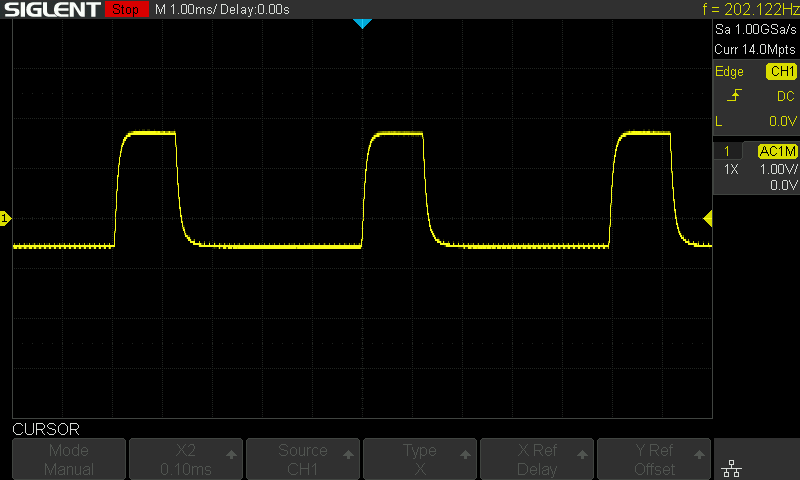
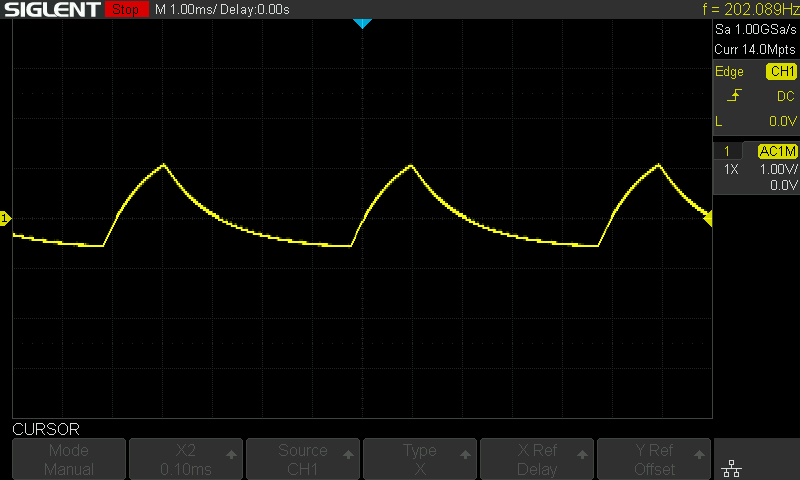

(Ich trage das hier für mich selbst auf, aber bedien dich gerne an meinem Wissen)

# Taschenlampen-Erkenner
Dieses "Projekt" is ein reines proof-of-concept.

Ich habe eine Taschenlampe, die über eine verringerte Helligkeitsstufe verfügt.
Die Helligkeit wird durch PWM verringert.

Über einen Lichtsensor (Photodiode) wird wird das PWM-Signal der Taschenlampe zuverlässig erkannt, selbst bei einer sehr hellen Umgebung.

Als Mikrocontroller nutze ich den STM32F030C8T6, ein wirklich billiges Modell.
Wenn der die Verarbeitung hinbekommt, schafft es eigentlich auch jeder andere STM32 Mikrocontroller.

# Technische Hintergründe/Betrachtung
Die Theorie kommt aus der Matched-Filter-Theorie.
Demnach ist die Antwort eines Filters maximal, wenn dessen Impulsantwort dem zeitlich Inversen des zu detektierenden Signals entspricht.

Für die Praxis bedeutet dies, dass man bei der Suche nach einem bestimmten Signalverlauf die Messwerte mit dem zeitlich Inversen des Verlaufs falten muss.
Klingt kompliziert, ist aber eigentlich sehr einfach.

Bisschen kacke in diesem Fall ist allerdings, dass das PWM-Signal der Taschenlampe harte Flanken hat.
Harte Flanken bedeuten immer hochfrequente Anteile, worauf ich unten genauer eingehe.

# Umsetzung
## Untersuchen des PWM-Signals
Erstmal muss untersucht werden, wie das Signal der Taschenlampe aussieht.

Dazu habe ich die Photodiode über einen Spannungsteiler an mein Oszilloskop angeschlossen.
Dann mit der Taschenlampe draufgeleuchtet und es ergab sich ein klarer PWM Verlauf:\

Mit dem Oszi lies sich bestimmen, dass die Periodendauer 5ms (f = 200 Hz) und die Ein-Zeit 1.3ms beträgt.
Das ist ein sehr langsames Signal, was erstmal ganz cool ist.
Aber natürlich musste die Frequenz ein Vielfaches der Netzfrequenz (50 Hz) sein, weswegen man von vielen gewöhnlichen Lampen Harmonien in dem Bereich erwarten kann.

Wichtig ist, dass der Gleichanteil rausgerechnet werden muss. Das Gerät soll in einer hellen Umgebung funktionieren, wo andere Leuchtquellen idealerweise nichts als Gleichanteil beitragen.
Die Lampe ist also niemals aus, sondern "sendet einen negativen Wert".
Ein Problem weniger.

## Vorfilter und Abtasten
PWM-Signale lassen sich super einfach nachbilden.
Es gibt nur 2 mögliche Werte: "Spannung"-An und "Spannung"-Aus.
Man muss also nichtmal einen Signalverlauf abspeichern, nur 2 Werte.

ABER.

Das Spektrum eines PWM-Signals ist irgendwas si-Förmiges mit unendlicher Bandbreite.
Um es also "echt genug" abzutasten, muss der A/D-Wandler theoretisch unendlich schnell sein.
Mein 1€ ARM-Cortex M0 ist leider nicht unendlich schnell, dessen A/D-Wandler schon gar nicht.

Es gibt 2 Möglichkeiten, mit dem Problem umzugehen:
1. Gar nicht. Man tastet einfach zu langsam ab und nimmt das entstehende Alias in Kauf. (Theoretisch könnte man das Alias auch abschätzen und beim Filterentwurf berücksichtigen)
2. Ein analoges Vorfilter nutzen und damit die hochfrequenten Anteile eliminieren. Das hätte auch den SEHR hilfreichen "neben"-Effekt, das aufgefangene Rauschen deutlich zu reduzieren.

Zunächst hab ich 1. probiert.
Alles schön kalibriert, dadurch die Fehlerkennungen so weit reduziert wie möglich.
Auch wenn das System sehr sensibel auf die Taschenlampe reagiert hat, hat es häufig "false-positive" erzeugt.

Dann habe ich einen RC-Tiefpass 1. Ordnung mit einer Grenzfrequenz von knapp unter 5kHz vorgeschaltet.

Mit Vorfilter sanken die false-positives ohne Neukalibrierungen quasi auf 0.
Die Taschenlampe wurde mit mindestens gleicher sensibilität erkannt.
Durch Neukalibrierung konnte die Sensibilität sogar noch erhöht werden.

Leider sieht das "empfangene" Signal jetzt anders aus:\

## Erkennen des Signals

