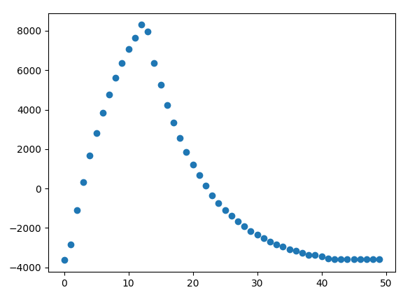

(Ich trage das hier für mich selbst auf, aber bedien dich gerne an meinem Wissen)

# Taschenlampen-Erkenner
Dieses "Projekt" is ein reines proof-of-concept.

Ich habe eine Taschenlampe, die über eine verringerte Helligkeitsstufe verfügt.
Die Helligkeit wird durch PWM verringert.

Über einen Lichtsensor (Photodiode) wird wird das PWM-Signal der Taschenlampe zuverlässig erkannt, selbst bei einer sehr hellen Umgebung.

Als Mikrocontroller nutze ich den STM32F030C8T6, ein wirklich billiges Modell.
Wenn der die Verarbeitung hinbekommt, schafft es eigentlich auch jeder andere STM32 Mikrocontroller.

# Technische Hintergründe/Betrachtung
Die Theorie kommt aus der Matched-Filter-Theorie.
Demnach ist die Antwort eines Filters maximal, wenn dessen Impulsantwort dem zeitlich Inversen des zu detektierenden Signals entspricht.

Für die Praxis bedeutet dies, dass man bei der Suche nach einem bestimmten Signalverlauf die Messwerte mit dem zeitlich Inversen des Verlaufs falten muss.
Klingt kompliziert, ist aber eigentlich sehr einfach.

Bisschen kacke in diesem Fall ist allerdings, dass das PWM-Signal der Taschenlampe harte Flanken hat.
Harte Flanken bedeuten immer hochfrequente Anteile, worauf ich unten genauer eingehe.

# Umsetzung
## Untersuchen des PWM-Signals
Erstmal muss untersucht werden, wie das Signal der Taschenlampe aussieht.

Dazu habe ich die Photodiode über einen Spannungsteiler an mein Oszilloskop angeschlossen.
Dann mit der Taschenlampe draufgeleuchtet und es ergab sich ein klarer PWM Verlauf:\

Mit dem Oszi lies sich bestimmen, dass die Periodendauer 5ms (f = 200 Hz) und die Ein-Zeit 1.3ms beträgt.
Das ist ein sehr langsames Signal, was erstmal ganz cool ist.
Aber natürlich musste die Frequenz ein Vielfaches der Netzfrequenz (50 Hz) sein, weswegen man von vielen gewöhnlichen Lampen Harmonien in dem Bereich erwarten kann.

Wichtig ist, dass der Gleichanteil rausgerechnet werden muss. Das Gerät soll in einer hellen Umgebung funktionieren, wo andere Leuchtquellen idealerweise nichts als Gleichanteil beitragen.
Die Lampe ist also niemals aus, sondern "sendet einen negativen Wert".
Ein Problem weniger.

## Vorfilter und Abtasten
PWM-Signale lassen sich super einfach nachbilden.
Es gibt nur 2 mögliche Werte: "Spannung"-An und "Spannung"-Aus.
Man muss also nichtmal einen Signalverlauf abspeichern, nur 2 Werte.

ABER.

Das Spektrum eines PWM-Signals ist irgendwas si-Förmiges mit unendlicher Bandbreite.
Um es also "echt genug" abzutasten, muss der A/D-Wandler theoretisch unendlich schnell sein.
Mein 1€ ARM-Cortex M0 ist leider nicht unendlich schnell, dessen A/D-Wandler schon gar nicht.

Es gibt 2 Möglichkeiten, mit dem Problem umzugehen:
1. Gar nicht. Man tastet einfach zu langsam ab und nimmt das entstehende Alias in Kauf. (Theoretisch könnte man das Alias auch abschätzen und beim Filterentwurf berücksichtigen)
2. Ein analoges Vorfilter nutzen und damit die hochfrequenten Anteile eliminieren. Das hätte auch den SEHR hilfreichen "neben"-Effekt, das aufgefangene Rauschen deutlich zu reduzieren.

Zunächst hab ich 1. probiert.
Alles schön kalibriert, dadurch die Fehlerkennungen so weit reduziert wie möglich.
Auch wenn das System sehr sensibel auf die Taschenlampe reagiert hat, hat es häufig "false-positive" erzeugt.

Dann habe ich einen RC-Tiefpass 1. Ordnung mit einer Grenzfrequenz von knapp unter 5kHz vorgeschaltet.

Mit Vorfilter sanken die false-positives ohne Neukalibrierungen quasi auf 0.
Die Taschenlampe wurde mit mindestens gleicher sensibilität erkannt.
Durch Neukalibrierung konnte die Sensibilität sogar noch erhöht werden.

Ich taste mit 10kHz ab, also alle 100us.

## Erkennen des Signals
Laut der Matched-Filter-Theorie muss ich das empfangene Signal mit dem zeitlich inversen "idealen Signal" falten.

Bei einem PWM-Signal ist das wie anfangs erwähnt recht einfach.

Leider sieht das "empfangene" Signal durch den Vorfilter jetzt so aus:\

Es funktioniert immernoch, wenn man ein PWM-Signal annimmt, jedoch deutlich ungenauer.

Also habe ich den Signalverlauf mit dem Oszilloskop aufgezeichnet und als CSV exportiert.
Dann habe ich mit einem Python-Skript exakt eine Periode des Signals extrahiert und auf 50 Punkte reduziert:\

Im Folgenden nenne ich diesen Verlauf "Vorlage".

Ich war zu faul, eine Mittlung durchzuführen, weswegen der entstandene Verlauf minimal verzerrt wirkt.
Aber durch einen einfachen digitalen Lowpass hab ich es gejagt.
Nachher natürlich noch den Gleichanteil entfernt, sehr wichtig!

Um die Faltung durchzuführen, werden die jeweils 50 aktuellsten Messungen in einem Array gespeichert (Ringpuffer).
Nach jeder Messung wird jede einzelne gepufferte Messung mit einem Wert der Vorlage multipliziert.
Die älteste Messung mit Index 0, die danach mit Index 1, usw.

Die Produkte dieser Multiplikationen werden addiert.

Diese Summe entspricht der Faltung mit dem Inversen der Vorlage.
Laut der Theorie ist diese maximal, wenn der gemessene Signalverlauf der Vorlage entspricht.

Natürlich springt dieses Filter auch auf andere Signalverläufe an, daher braucht es eine gewisse Entscheidungsschwelle.
Also: "ab welchem Faltungswert wird das Signal zuverlässig erkannt, Störungen aber noch abgeblockt?"
Ich habe durch Ausprobieren einen sinnvollen Wert ermittelt und konfiguriert.

# Nachfiltern
Trotz der wirklich guten Detektion des Signals ist es möglich, dass ungewollte Signalverläufe den Entscheider "überleben".
Also dass der Faltungswert eines fremden Signals oberhalb der Schwelle liegt.
Genauso ist es möglich, dass ein korrekter Signalverlauf im Signal enthalten ist, aber so schwach, dass es "übersehen" wird.

Es ist ein Kompromiss zwischen Sensibilität und Zuverlässigkeit.
Der Sensor ist witzlos, wenn man die Taschenlampe 1cm vor ihn halten muss, um ihn auszulösen.
Genauso witzlos wäre er, wenn er ständig falsch auslöst.

Stattdessen wird ein längerer Teil des Signals betrachtet.
Die Messung wird langsamer, dafür sinkt jedoch die Chance eines fehlerhaften Auslösens.

Faltungen sind teuer (rechenintensiv), weswegen ich mich dafür entschied, die Signalvorlage nicht zu "vergrößern", also einen Signalverlauf mit 10-20 Perioden zu "suchen".

Stattdessen wird für jede Periode gezählt, wie viele Faltungen die Schwelle überschritten haben.
Sind es ausreichend viele, wird angenommen, dass diese Periode korrekt detektiert wurde.

Genauso können "eine Ebene höher" ganze Perioden zusammengefasst werden.
Gelten n ganze Perioden als "korrekt detektiert", wird angenommen, dass das gesuchte Signal tatsächlich vorliegt.

Es stehen insgesamt also 3 Schwellen zur Verfügung, um die Sensibilität des Detektors einzustellen:
- Schwelle der Faltung
- Schwelle der Periode
- Schwelle mehrerer Perioden

## Mögliche Verbesserung
Alternativ könnte ein "Trend" ermittelt werden.
Dazu wird ein Zähler genutzt, der bei erfolgreicher Periode hoch und ansonsten runter zählt.
Liegt der Zähler über einer gewissen Schwelle, gilt das Signal als detektiert.

So ergibt sich eine Art Hystereseverhalten: Wird ein Signal länger erkannt, muss es auch länger weggenommen sein, bis der Detektor ausschaltet.

Der Zähler wird natürlich nach oben und unten begrenzt.

# Ergebnis / Fazit
Der entstandene Detektor übertrifft die Erwartungen deutlich.

## Raumbeleuchtung
Bei normaler Raumbeleuchtung erkennt er die Taschenlampe zuverlässig selbst vom anderen Ende des Raumes aus (5m).

Die Richtcharakteristik der Photodiode ist deutlich spürbar.
Aus ca. 2m Entfernung messe ich (sehr ungenau) einen Öffnungswinkel von 80°.
Ein 3d-gedruckter Diffusor könnte ausreichend sein, um den Öffnungswinkel auf 180° zu erhöhen.

Trotzdem steht der Detektor seit ca. einer Stunde inaktiv neben mir, ohne einmal fehlerhaft ausgelöst zu haben.
Er scheint für Innenräume gut geeignet zu sein.

## Starke, direkte Beleuchtung
Um einen Extremfall zu simulieren habe ich mit meiner Handytaschenlampe helles Dauerlicht aus ca. 5 cm Entfernung frontal auf den Detektor geleuchte.

Die Sensibilität lässt stark nach, sodass die Taschenlampe direkt vor den Sensor (1 cm) gehalten muss, um eine Auslösung zu verursachen.

Es treten keine Falschauslösungen auf.

Offensichtlich überschreitet eine derartig starke, frontale Beleuchtung den Dynamikbereich des Sensors.
Ein logarithmischer Detektor könnte das Problem umgehen, umfasst allerdings deutlich mehr (und teurere!) Bauteile.

## Starke, seitliche Beleuchtung
Das selbe Dauerlicht wie im vorherigen Abschnitt wurde aus ca. 5 cm Entfernung seitlich auf den Detektor geleuchtet.

Der Sensor löst bei einer Entfernung von bis zu ca. 30 cm frontaler Beleuchtung aus.
Der Öffnungswinkel bei ca. 20cm beträgt ca. 20°.

## Sonnenlicht
Direktes Sonnenlicht ist vermutlich der ungünstigste Anwendungsfall, da die Photodiode besonders sensibel auf Infrarotes Licht reagiert.

Der Test wird erstmal zurückgestellt, da ich ihn nicht bei Nacht vom Schreibtisch aus durchführen kann.

